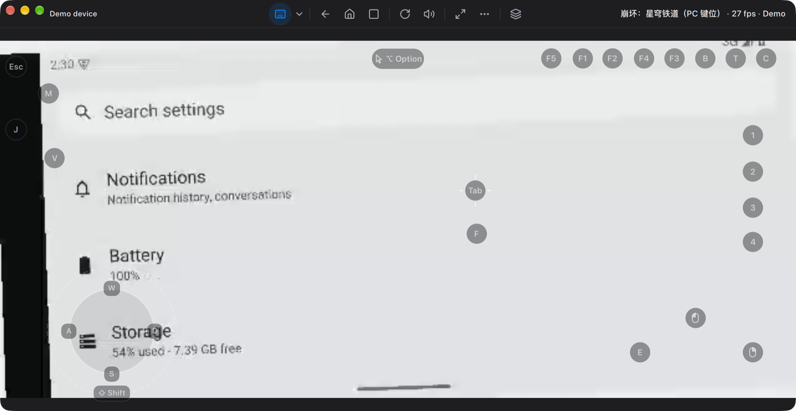

<div align="center">


# anmacgamer

Mirror an Android phone to macOS, map keyboard, mouse, and gamepads to touches, and automate actions with blueprints or TypeScript.

[](https://github.com/wyb-070110/anmacgamer/releases)
[](LICENSING.md)
[](#requirements)

English · [简体中文](README.zh-CN.md)

[Releases](https://github.com/wyb-070110/anmacgamer/releases) · [Documentation](docs/README.md) · [macOS port notes](docs/macos-port.md) · [Changelog](CHANGELOG.md)



</div>

anmacgamer is a native macOS port of [NuoRan/GameScrcpy](https://github.com/NuoRan/GameScrcpy) (Apache-2.0), maintained by [@wyb-070110](https://github.com/wyb-070110). Its mirroring design traces back to [scrcpy](https://github.com/Genymobile/scrcpy).

## Requirements

- Mac: macOS 14 Sonoma or later (Apple silicon or Intel, universal)
- Phone: Android 9 or later (Android 11+ for audio forwarding and wireless pairing)
- Connection: USB cable, or Wi-Fi / Ethernet on the same local network

## Install

1. Download the `.dmg` from [Releases](https://github.com/wyb-070110/anmacgamer/releases) and drag `anmacgamer.app` to Applications.
2. Beta builds are unsigned. On first launch, right-click the app and choose **Open**. If macOS reports it is damaged, run once in Terminal:
   ```bash
   xattr -dr com.apple.quarantine /Applications/anmacgamer.app
   ```
3. Turn on Developer options and USB debugging (or Wireless debugging) on the phone. Connect it, then click **Mirror** on the Devices page. Press `F1` for built-in help.

## What works

- Video and audio: hardware H.264/H.265 decoding, AV1 decoding, Metal rendering, and phone audio playback on Android 11+.
- Connections: USB (with bundled `adb` and AOA v2 HID touch), wireless debugging (code or QR), Wi-Fi direct with adb fallback, and **anmacgamer Companion** over Bonjour. Without USB debugging, the companion sends picture and sound over Wi-Fi while touch goes over the cable (AOA).
- Input: keyboard, mouse, two-finger trackpad swipes, Xbox/PS4/PS5 controllers with rumble, direct Mac typing (including Chinese pinyin) via the Companion input method, and a built-in PC profile for Honkai: Star Rail.
- Window and tools: single or multi-device grid windows, MP4 recording, screen-off mirroring, file and app manager, virtual display app launch, and latency measurement.
- Automation and extensions: blueprints and TypeScript scripts (with image/color matching, OCR, speech, and schedules), the `gs` CLI, local MCP server, AI assistant, `.gsext`/`.gsbundle` extensions, native `.dylib` extensions, serial ports, and `gamescrcpy://` links.

## Not yet

- Companion mirroring over the USB cable (picture and sound go over Wi-Fi for now)
- HDMI capture cards and Bluetooth LE peripherals
- Custom extension video shader filters (HLSL on Metal)
- In-editor TypeScript type checking on Intel Macs (scripts still run)
- Apple Developer ID notarization (beta `.dmg` builds are unsigned)

See [docs/macos-port.md](docs/macos-port.md) for current port status.

## Build from source

Install tools and Qt 6.10.3 (`~/Qt/6.10.3/macos`, or pass `-DCMAKE_PREFIX_PATH=<path>`):

```bash
xcode-select --install
brew install cmake ninja openssl@3 ffmpeg sdl3 libusb android-platform-tools
```

Configure, build, and test:

```bash
cmake --preset mac-app
cmake --build --preset mac-app
ctest --preset mac-app
```

Try the mirror window without a phone:

```bash
./build/mac-app/bin/anmacgamer.app/Contents/MacOS/anmacgamer --demo-device tests/data/video/emulator_h265.media
```

Build only the Qt-free core libraries with `cmake --workflow --preset posix-core`. For universal `.dmg` builds (`mac-release`), see `tools/build_macos_deps.sh` and `packaging/macos/package.sh`. User data lives in `~/Library/Application Support/anmacgamer`.

## Documentation

- [User guide](docs/README.md) (same pages as `F1` in the app)
- [macOS port notes](docs/macos-port.md) · [Architecture](docs/architecture.md)
- [Script API reference](sdk/docs/README.md) · [Writing extensions](docs/extensions/README.md)
- [Protocol specification](protocol/SPEC.md) · [Contributing](CONTRIBUTING.md)

## Feedback and security

- Bugs and requests: [GitHub Issues](https://github.com/wyb-070110/anmacgamer/issues) (attach **Settings > About > Export diagnostics** for bugs).
- Security issues: report privately via [GitHub Security](https://github.com/wyb-070110/anmacgamer/security/advisories/new) as described in [SECURITY.md](SECURITY.md).

## License and credits

Code written for anmacgamer on macOS is licensed under [GNU GPL 3.0 or later](LICENSES/GPL-3.0-or-later.txt). Code kept from upstream remains under the [Apache License 2.0](LICENSE). The distributed macOS application as a whole is offered under **GPL 3.0 or later**. See [LICENSING.md](LICENSING.md) for details.

- Upstream: built upon [NuoRan/GameScrcpy](https://github.com/NuoRan/GameScrcpy) (Apache License 2.0). Thanks to the upstream author. Please report problems with anmacgamer in this repository, not upstream.
- [scrcpy](https://github.com/Genymobile/scrcpy) and [QtScrcpy](https://github.com/barry-ran/QtScrcpy).
- Third-party libraries and licenses: [third_party/README.md](third_party/README.md), [LICENSING.md](LICENSING.md), and **Settings > About > Open-source licenses**.
