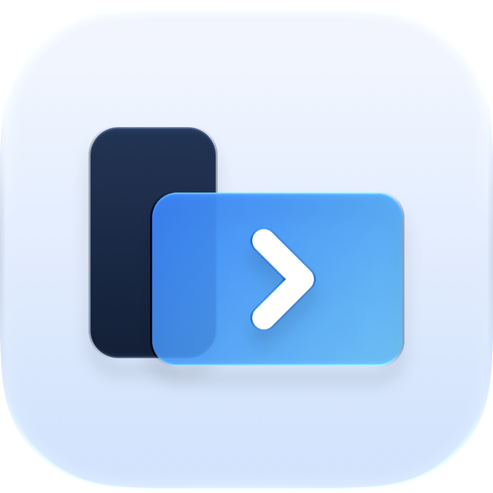

<div align="center">



# anmacgamer

Android screen mirroring, key and gamepad mapping, and script automation for macOS.

[](https://github.com/wyb-070110/anmacgamer/releases)
[](LICENSING.md)
[](#requirements)

English · [简体中文](README.zh-CN.md)

[Releases](https://github.com/wyb-070110/anmacgamer/releases) · [Documentation](docs/README.md) · [macOS port notes](docs/macos-port.md) · [Changelog](CHANGELOG.md)


</div>

anmacgamer is a native macOS port of [NuoRan/GameScrcpy](https://github.com/NuoRan/GameScrcpy) (Apache-2.0), maintained by [@wyb-070110](https://github.com/wyb-070110). Its mirroring design traces back to [scrcpy](https://github.com/Genymobile/scrcpy).

It mirrors Android phones to a Mac over USB or Wi-Fi, maps keyboard, mouse, trackpad, and controller input to touches, and runs automation written as either blueprints or TypeScript. The interface ships in English and Simplified Chinese, and language pack extensions can add more.

## What works

- Video and audio: hardware decoding via VideoToolbox (H.264, H.265) and dav1d (AV1), rendered through Qt RHI on Metal and paced to display refresh. Phone audio plays through SDL3 on Android 11+ (captured at fixed volume so macOS controls playback level).
- Connections: USB (`adb` bundled, libusb hotplug, AOA v2 HID touch), Android wireless debugging (6-digit pairing code or QR), WiFi direct (UDP with Reed-Solomon FEC, falling back to the adb tunnel when direct UDP cannot connect), and the Companion app over Bonjour.
- Input: keyboard and mouse mapping inside the mirror window without needing Input Monitoring permission, a built-in PC-style profile for Honkai: Star Rail, direct Mac keyboard typing (including Chinese pinyin composition) via the Companion input method without popping up the phone's soft keyboard, Xbox/PS4/PS5 controllers with rumble via SDL3, and two-finger trackpad swipes (direct by default, plus page turn, natural fling, and scroll wheel modes).
- macOS integration: Liquid Glass styling following system light/dark mode and Reduce Transparency, native menu bar, status bar icon and notifications, aspect-locked mirror windows or multi-device grid, customizable toolbar on any side, always-on-top across Spaces, option to turn the phone screen off while mirroring, MP4 recording, file and app management, virtual display app launch, and latency measurement.
- Automation and tools: blueprints and TypeScript share the same source files, isolated in a `sandbox_init`-confined `gs-scripthost` process. Includes template and color matching, macOS Vision OCR, `AVSpeechSynthesizer` / `SFSpeechRecognizer` speech, scheduled tasks, the `gs` CLI, a local MCP server over a Unix socket, an AI assistant (API keys in Keychain), `.gsext` / `.gsbundle` extensions, sandboxed `.dylib` native extensions (`gs-exthost`), IOKit `/dev/cu.*` serial ports, and `gamescrcpy://` links.

## Not yet

- Mirroring without adb through the Companion app (built, being tested on phones)
- HDMI capture cards
- Bluetooth LE peripherals
- Custom extension video shader filters (HLSL on Metal)
- TypeScript type checking inside the editor on Intel Macs (scripts still run)
- Apple Developer ID notarization (beta `.dmg` builds are unsigned)

See [docs/macos-port.md](docs/macos-port.md) for current port status and test results.

## Requirements

| | |
|:--|:--|
| Mac | macOS 14 Sonoma or later (Apple silicon or Intel) |
| Phone | Android 9 or later (Android 11+ for audio forwarding and wireless debugging pairing) |
| Connection | USB cable, or Wi-Fi / Ethernet on the same local network |

## Install

1. Download the universal `.dmg` from [Releases](https://github.com/wyb-070110/anmacgamer/releases) and drag the app to Applications.
2. Beta builds are unsigned. On first launch, right-click the app in Applications and choose **Open**. If macOS says the app is damaged, run once in Terminal:
   ```bash
   xattr -dr com.apple.quarantine /Applications/anmacgamer.app
   ```
3. Enable **Developer options** and **USB debugging** (or **Wireless debugging**) on the phone, connect it, and click **Mirror** on the Devices page. Press `F1` for built-in help.

## Build from source

Install build dependencies:

```bash
xcode-select --install
brew install cmake ninja openssl@3 ffmpeg sdl3 libusb android-platform-tools
```

Install Qt 6.10.3 for macOS to `~/Qt/6.10.3/macos` (or pass `-DCMAKE_PREFIX_PATH=<path>`).

Configure, build, and test:

```bash
cmake --preset mac-app
cmake --build --preset mac-app
ctest --preset mac-app
```

Run the mirror window without a phone:

```bash
./build/mac-app/bin/anmacgamer.app/Contents/MacOS/anmacgamer --demo-device tests/data/video/emulator_h265.media
```

Build and test only the Qt-free core libraries:

```bash
cmake --workflow --preset posix-core
```

For universal `.dmg` packaging (`arm64` + `x86_64`, macOS 14+, bundling LGPL dependencies and `adb`), see `tools/build_macos_deps.sh` and `packaging/macos/package.sh`. App settings, profiles, extensions, and logs are stored in `~/Library/Application Support/anmacgamer`.

## Documentation

| Topic | Location |
|:--|:--|
| User guide (same pages as `F1` in the app) | [docs/README.md](docs/README.md) |
| macOS port notes and architecture | [docs/macos-port.md](docs/macos-port.md) · [docs/architecture.md](docs/architecture.md) |
| Script API reference | [sdk/docs/README.md](sdk/docs/README.md) |
| Writing extensions | [docs/extensions/README.md](docs/extensions/README.md) |
| Protocol specification | [protocol/SPEC.md](protocol/SPEC.md) |
| Contributing | [CONTRIBUTING.md](CONTRIBUTING.md) |

## Feedback and security

- Bug reports and feature requests: [GitHub Issues](https://github.com/wyb-070110/anmacgamer/issues). Attach the archive from **Settings > About > Export diagnostics** when reporting a bug.
- Security issues: do not open a public issue. Report privately through the [GitHub Security page](https://github.com/wyb-070110/anmacgamer/security/advisories/new) as described in [SECURITY.md](SECURITY.md).

## License and credits

Code written for anmacgamer on macOS is licensed under [GNU GPL 3.0 or later](LICENSES/GPL-3.0-or-later.txt). Code kept from upstream remains under the [Apache License 2.0](LICENSE). The distributed macOS application as a whole is offered under **GPL 3.0 or later**. See [LICENSING.md](LICENSING.md) for details.

- Upstream: built upon [NuoRan/GameScrcpy](https://github.com/NuoRan/GameScrcpy) (Apache License 2.0). Thanks to the upstream author.
- [scrcpy](https://github.com/Genymobile/scrcpy): pioneered low-latency Android mirroring and inspired the design.
- [QtScrcpy](https://github.com/barry-ran/QtScrcpy): the base of GameScrcpy 1.x.
- Third-party libraries (Qt, FFmpeg, dav1d, SDL3, OpenSSL, libusb, QuickJS-ng, TypeScript, QWindowKit, nlohmann/json, miniz, QR Code generator, Lucide, doctest, tl::expected) and their licenses are listed in [third_party/README.md](third_party/README.md), [LICENSING.md](LICENSING.md), and inside the app under **Settings > About > Open-source licenses**.
