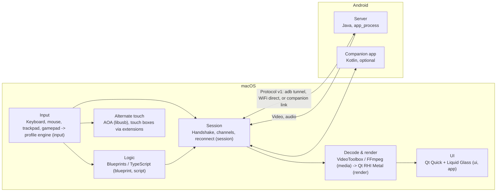

# anmacgamer Architecture

A Qt Quick app on macOS talks to a Java server on the Android phone over a shared binary protocol. Video decodes via VideoToolbox (H.264/H.265) or dav1d (AV1) and renders through Qt Quick on Metal. Input flows through the profile mapping engine and, when a profile has logic, TypeScript in QuickJS. All core modules build without Qt.

## Overview

## Processes

| Process | Role |
|:--|:--|
| `anmacgamer.app` | Main app: UI, sessions, decode/render, key mapping, profile logic, local MCP server, AI assistant |
| `gs` | CLI: profile scaffolding, type-check, replay tests, SDK generation, MCP stdio relay |
| `gs-exthost` | Sandboxed process for native `.dylib` extensions so crashes stay isolated |
| `gs-scripthost` | Low-privilege `sandbox_init` process for extension logic |
| Phone server | Java process pushed via `adb` (`app_process`): captures video/audio, injects input, manages clipboard/files/apps |
| `anmacgamer Companion` | Optional Kotlin Android app: on-phone cursor/key hints, Mac-typing IME, QR pairing, adb-free mirroring |

External touch boxes (such as ESP32 boards) live in community extensions built on the public extension API.

## macOS modules (`src/`)

Core modules are Qt-free C++20/ObjC++20 (`posix-core` preset). Only `render`, `ui`, and `app` use Qt.

| Module | Responsibility |
|:--|:--|
| `base` | `Expected`, logging, clocks, endianness, SPSC queues, thread checks |
| `platform` | POSIX/macOS layer: sockets, OpenSSL, Keychain, libusb/AOA, speech, Vision OCR, input capture, notifications |
| `protocol` | Binary protocol v1 codec sharing golden vectors in `protocol/vectors/` with `android/protocol` |
| `adb` | Native adb host-protocol client (tracking, shell, push, port forwarding) |
| `session` | Server launch, handshake, channels, keepalive, reconnect (adb tunnel, Wi-Fi direct + FEC, companion link) |
| `media` | FFmpeg + VideoToolbox/dav1d decoding; SDL3 audio playback |
| `render` | Qt RHI (Metal) NV12/P010/YUV420 rendering paced to display refresh |
| `input` | Input capture, profile format, anchor + short-side coordinates, touch frame engine |
| `hardware`, `capture` | IOKit `/dev/cu.*` serial ports; capture card and black-bar crop framework |
| `record`, `vision` | Video/audio/input recording, MP4 export, template/color matching with SIMD |
| `tsstrip`, `blueprint`, `script` | Type stripping, two-way TS/blueprint conversion, QuickJS-ng runtime, replay, SDK generation |
| `ext`, `scripthost`, `exthost` | Extension manifests/permissions, Mach-O checks, `sandbox_init` hosts |
| `cli`, `ui`, `app` | `gs` CLI; QML theme/icons/controls/blueprint UI; main app, MCP server, AI client, built-in help |

## Android modules (`android/`)

- `protocol`: Java codec verified against the same golden vectors as C++.
- `server`: plain Java (no Kotlin), release APK under 256 KB.
- `companion`: Kotlin Companion app.

## Design rules

- Shared protocol: change `protocol/SPEC.md` and `protocol/tools/gen_vectors.py` first; C++ and Java must match all vectors byte for byte.
- No fixed-delay sync or `dumpsys`/`wm` parsing in product code (enforced by `tools/check_source_rules.py`).
- Threading: UI, decode, input, and per-session logic run on separate threads so UI stalls never delay input.
- Blueprints are TypeScript: profile logic is stored as TypeScript files; blueprints edit the same files.
- Data and builds: user data lives in `~/Library/Application Support/anmacgamer` (`GS_DATA_DIR` overrides it). CMake configure runs offline using `third_party/`.
